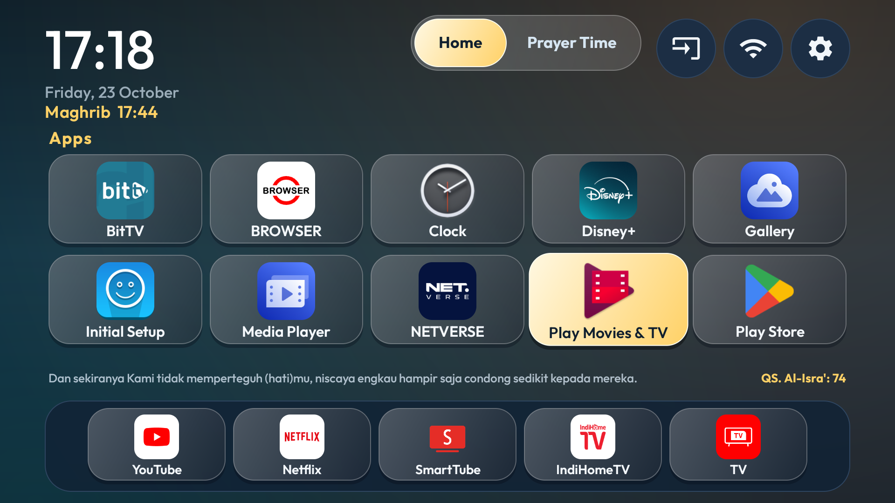
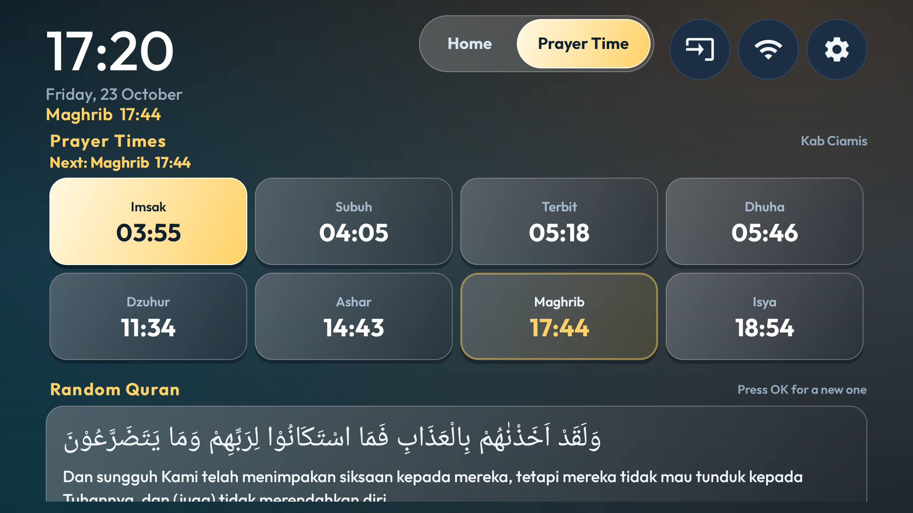
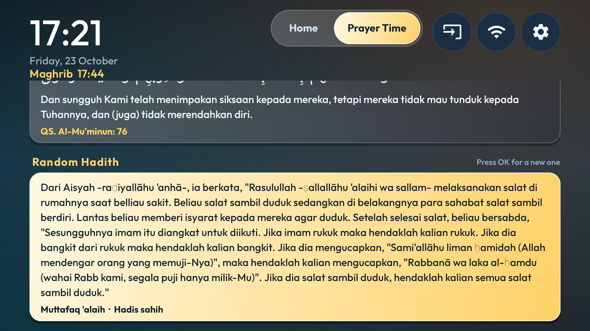
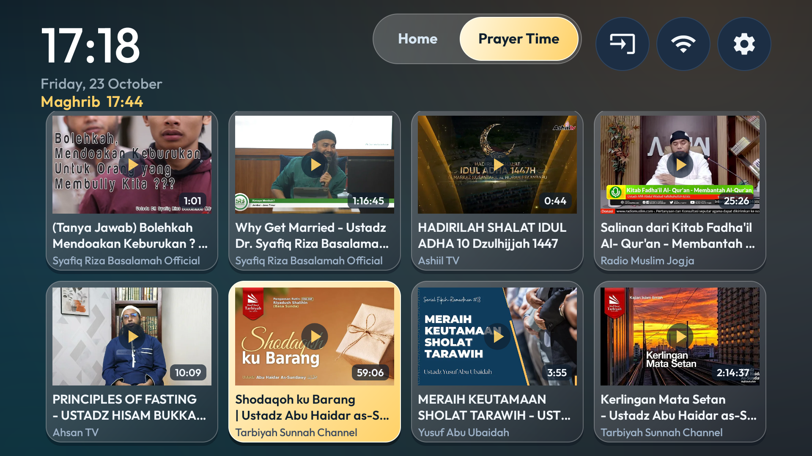

# TV Debloat and Launcher

This repository contains the native Android TV launcher in `launcher/` and
ADB utilities in `tools/`. The device scripts default to the relay at
`127.0.0.1:15555`; leave `tools/relay.py <TV-IP>` running in a regular
Terminal and use `TV_HOST` / `TV_PORT` to override it.

## Screenshots

**Home** — frosted-glass cards, the segmented page switch, the next prayer
under the clock, and a random verse under the favourites row (these shots
predate the Home / Apps tab split):



**Prayer Time** — all eight prayer times with the next one highlighted, the
place name from the TV's own location ("Ciamis, Jawa Barat" in the example),
and a random Quran card (Arabic RTL, translation LTR):



**Random hadith** (OK draws a new one) and the **4-wide random video grid**
(OK plays a video in leanback YouTube):





## Clone

```sh
git clone https://github.com/gifary/tv-laucher.git
cd tv-laucher
```

What you need to build it yourself:

- An Android SDK with `launcher/local.properties` pointing at it
  (`sdk.dir=/path/to/Android/sdk`). That file is gitignored on purpose.
- Gradle compatible with Android Gradle Plugin 8.7.3 (Gradle 8.9 works):

```sh
gradle -p launcher assembleDebug
```

- A TV reachable over ADB for `tools/tv.py` (`TV_HOST` / `TV_PORT`, default
  `127.0.0.1:15555` through `tools/relay.py`).

Install the APK and switch the remote-key service back on afterwards, because
an install resets it; `tools/remote-keys.sh` does that and leaves any other
accessibility service alone. The prayer alerts also need the media pause
listener allowed — it pauses a playing video when the adhan starts:

```sh
python3 tools/tv.py --install launcher/app/build/outputs/apk/debug/app-debug.apk
bash tools/remote-keys.sh
python3 tools/tv.py shell 'cmd notification allow_listener dev.gtv.launcher/dev.gtv.launcher.MediaPauseListener'
```

`backup/`, `apk/`, `disabled-by-us.txt`, and `shots/` (beyond the four images
above) are local-only and gitignored: they hold device captures and your own
debug screenshots rather than anything another clone would use.

## Device safety and recovery

Run `bash tools/backup.sh` before changing the TV. It saves package lists,
properties, settings, display values, HOME activities, and package dumps under
`backup/<timestamp>/`.

`disabled-by-us.txt` is the restore ledger, kept locally (it is gitignored —
create one in your clone as you disable packages). Record each package
disabled by this project there. To re-enable those entries, run:

```sh
bash tools/restore.sh
```

You can also pass another package-list file. The restore script runs one
`pm enable` command per package and checks the disabled list after each one.
To restore one app only, run `python3 tools/tv.py 'pm enable --user 0 <package>'`
and check it with `python3 tools/tv.py 'pm list packages -d'`.

The latest TCL G07 backup is written to `backup/20261023-144252/` on the
machine that ran `bash tools/backup.sh` (that directory is gitignored). It
records Android 11 / SDK 30, the package and settings state before the
requested app changes, and the existing disabled-package baseline. Video
(`com.google.android.videos`), Prime Video, and WeTV are now enabled; other
optional streaming and casting packages retain their previous states.

## App and remote key changes

The requested Video (`com.google.android.videos`), Prime Video
(`com.amazon.amazonvideo.livingroom`), WeTV (`com.tencent.qqlivei18n`), and
VIDIO (`com.vidio.android.tv`) packages are enabled. VIDIO is also included in
the launcher's app shortcut configuration. To enable or disable a single
app later, use `python3 tools/tv.py 'pm enable --user 0 <package>'` or
`python3 tools/tv.py 'pm disable-user --user 0 <package>'`. The current
disabled-package ledger contains only packages that remain disabled.

The launcher accessibility service maps the physical Settings, Netflix,
YouTube, VIDIO, Prime Video, and WeTV buttons using Android `KeyEvent` scan
codes 233, 242, 245, 743, 752, and 747 (`TCL_VIDIO`, Prime Video, WeTV) in
`launcher/app/src/main/res/values/config.xml`. The Prime Video and WeTV buttons
are repurposed: Prime Video opens SmartTube and WeTV opens BitTV. Enable the
service in Android Settings under Accessibility > Remote shortcut keys. To turn
those mappings off, disable that accessibility service there. The service must
be enabled and bound for the current user for the remote buttons to work. The
VIDIO button opens VIDIO's profile picker.

Some TVs drop that accessibility grant when the APK is reinstalled or the app
is force-stopped, which makes every shortcut button stop responding while the
mapping in `config.xml` is still correct. `bash tools/remote-keys.sh` puts the
grant back (it keeps any other enabled accessibility service) and prints the
bound state; long-pressing the gear pill on Home also opens the accessibility
settings screen.

## Build and install

After choosing the launcher apps and order, run:

```sh
bash tools/build-install.sh
```

The script checks the device SDK against `minSdk`, tries the existing debug
APK first to check that the TV accepts this HOME launcher, and stops if that
install fails. It then builds and installs the current source with `pm install
-r`. It does not set the default HOME app or disable the stock launcher; do
those only after checking HOME claimants and the device-specific recovery path.

## Favourites and wallpaper

The Home favourites are the package names in
`launcher/app/src/main/res/values/config.xml`, in the `favorite_apps` string
array; that order is the on-screen order. Only include packages installed on
the TV — a favourite that is not installed is skipped rather than leaving a
hole. Set the `columns` integer to the favourite count (4, 5, 6, or 7) so a
full list stays a single row of large tiles; the Apps page uses the same
column count. Every other installed app lives on the Apps page.

The launcher is tuned for comfortable viewing from a couch: the top bar is
kept compact (small clock block, 42dp tab switch, 50dp utility pills) so the
pages get the height, the Apps grid labels stay 15sp or larger, and every
card is frosted glass like an app icon — the focused card lights up amber
with dark text. Home cards are icon-only, so their icons have to carry the
identification.

Keep the app label sizes at 15sp or larger and the focus colors high-contrast
when changing the layouts.

## Home, Apps and Prayer Time pages

The header carries a segmented switch (a glass track with a capsule that
slides) with three pages:

- **Home** — clock with the Gregorian date, the Hijri date under it and the
  next prayer under that; a random Quran verse at the top of the content area,
  and the favourite cards as wide icon-only tiles pinned to the bottom edge
  (tinted by the ambient glow of the focused app), with the utility pills.
- **Apps** — every installed launcher app in alphabetical order, including the
  favourites, so no app becomes unreachable.
- **Prayer Time** — today's full schedule, all eight times with the next
  prayer highlighted and the place name (for example "Ciamis, Jawa Barat")
  reverse geocoded from the TV's own coordinates; then a random Quran card
  with the Arabic in RTL and the translation in LTR, a random hadith with
  its takhrij, and a 4-wide grid of random videos. Pressing OK on a video
  opens it in leanback YouTube.

Left/Right on the switch changes pages, OK steps into the page's content,
Down from the switch enters the content, and Back returns to Home from either
of the other pages.

Prayer times are calculated from the TV's own coordinates through
`api.aladhan.com` with KEMENAG's calculation method (`prayer_method_id`,
20), and the place name above the schedule is reverse geocoded from those
coordinates through OpenStreetMap's Nominatim and cached until the TV moves
a few kilometres. Location permission is asked for on first launch; when the
TV has no fix (permission refused, no provider), the schedule falls back to
`prayer_location_id` in `api.myquran.com` and to the `prayer_location_label`
name. KEMENAG publishes no Dhuha time, so that tile stays blank (`--:--`).

The verse, the hadith, and the videos are fetched from the API URLs in
`config.xml` (`verse_api`, `hadith_api`, `video_api`) and cached in
SharedPreferences, so the pages keep showing the last content offline.
Thumbnails are decoded through `Net.java`, which also keeps a small in-memory
bitmap cache.

The wallpaper is the Masjid an-Nabawi photo at dusk
(`res/drawable-nodpi/medina2.png`) with a vertical scrim on top of it, both
layered in `launcher/app/src/main/res/drawable/wallpaper.xml`. The scrim
darkens the header and the favourite row so the clock and cards stay readable
while the middle of the photo stays clear. Swapping in another photo means
replacing `medina2.png` (16:9 works best, since the bitmap fills the screen)
and adjusting the scrim stops if the new image is brighter or darker. The same
photo is kept at the repository root as `medina2.png`.

## Prayer alerts

With `prayer_alerts_enabled` set in `config.xml`, the launcher watches the
five prayers:

- `prayer_alert_lead_minutes` (5) before prayer time a notification is
  posted and, while Home is in front, an amber banner appears under the
  clock.
- At prayer time the adhan starts: the sound first, then a full-screen
  notification raises the adhan screen over whatever is playing, while
  `MediaPauseListener` (a notification listener) pauses the playing video
  a moment earlier. The screen shows the prayer in very large type over the
  Masjid an-Nabawi photo (`res/drawable-nodpi/nabawi.png`), the time, the
  place, and an iOS-style glass Stop button; there is no countdown because
  the screen closes by itself as soon as the adhan finishes. **OK or Back
  stops it early.** `adhan_max_minutes` (15) is only a safety cap for a file
  that reports no length. The photo is shipped as
  `res/drawable-nodpi/nabawi.png`; the original is `nabawi.png` at the
  repository root.

The sound is a CC0 recording, *Beautiful adhan* by Adam-synagda from
Wikimedia Commons (CC0 1.0), shipped as
`launcher/app/src/main/res/raw/adhan.ogg`; it plays once (about 2½ minutes)
and needs no timer. If the file is missing the device's alarm tone is used
instead. It plays on the media stream at whatever volume the family has set
— the launcher never changes the volume.

The alarms are exact (`setExactAndAllowWhileIdle`, falling back to a
non-exact alarm where Android 12+ refuses) and re-armed on boot, after
every schedule refresh, and at midnight. Setting
`prayer_alert_test_delay_seconds` above zero swaps the real pair for a test
one — reminder at now + N seconds and the adhan ten seconds later — which
is handy for trying the flow on a device; leave it at 0.

The launcher asks for location and, on Android 13+, notification permission
on first launch. After an install, allow the media pause listener:

```sh
python3 tools/tv.py shell 'cmd notification allow_listener dev.gtv.launcher/dev.gtv.launcher.MediaPauseListener'
```

## Optional Private DNS

On Android 9 and newer, an ad-blocking Private DNS resolver can block many
ads, but it does not block YouTube ads. To enable AdGuard DNS:

```sh
python3 tools/tv.py 'settings put global private_dns_specifier dns.adguard-dns.com'
python3 tools/tv.py 'settings put global private_dns_mode hostname'
```

Check that the TV's apps still connect and play. To undo the hostname-mode
setting:

```sh
python3 tools/tv.py 'settings put global private_dns_mode opportunistic'
```
